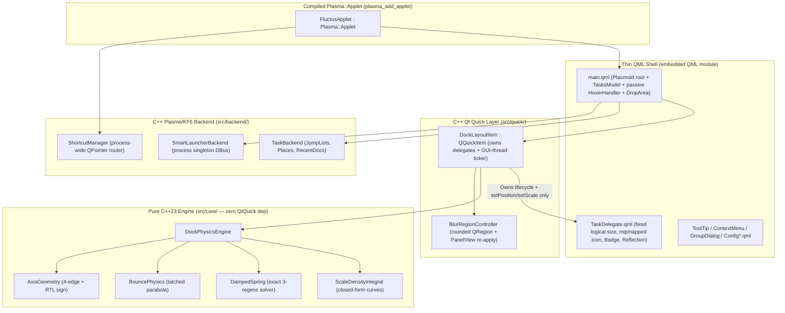

# Fluctus Plasma — Target Architecture & Engineering Standards

## 1. Core Architectural Principle: Compiled `Plasma::Applet` + C++-Owned Layout & Physics

All math, physics, delegate layout, and system integration live in **modern C++23**, compiled as a native `Plasma::Applet` (`plasma_add_applet`). QML is strictly a thin declarative shell for Plasma UI (delegate visuals, PipeWire tooltips, context menus, group dialog, and Kirigami config pages).



---

## 2. Key Qt Quick Design Rules (Preventing Frame Stutter & Thread Bugs)

1. **Strictly GUI-Thread Animation Loop (Never `beforeSynchronizing`):**
   - `QQuickWindow::beforeSynchronizing` runs on the **render thread** in `plasmashell`'s threaded render loop; mutating `QQuickItem` properties there is thread-unsafe.
   - `DockLayoutItem` drives physics strictly on the **GUI thread** using a `QAbstractAnimation` subclass (`duration() == -1`) stepped in `updateCurrentTime(int currentTime)` (deriving `dt` from the animation clock) — started on hover/bounce/model change and stopped immediately when `DockPhysicsEngine::isSettled()` is `true` (`0%` idle CPU/GPU).
2. **`DockLayoutItem` Owns Delegate Instantiation (No `Repeater`):**
   - `Repeater` destroys delegates immediately on `rowsRemoved` (breaking removal-weight animations) and desynchronizes `childItems()` order after `rowsMoved`.
   - `DockLayoutItem` exposes `model` (`QAbstractItemModel*`) and `delegate` (`QQmlComponent*`), instantiating delegates via `beginCreate` → `setInitialProperties` → `completeCreate`, tracked by `QPersistentModelIndex`.
   - Removed rows transition into **ghost slots** whose weight springs animate to `0` before `deleteLater()`.
   - **Invariant:** Delegates must never bind `x`, `y`, `width`, `height`, or `scale` in QML; debug builds assert/warn if any geometry binding is detected.
3. **Scale-Only Per-Frame Updates (Never `setSize` Per Frame):**
   - Every delegate is sized once to fixed logical `ceil(s₀ · M)` (recomputed only when `iconSize`, `maxScale`, or `devicePixelRatio` changes).
   - Per-frame animation calls **`setPosition(...)` and `setScale(...)` only**, with `transformOrigin` set per `DockEdge` (`Bottom`, `Top`, `Left`, `Right`) so icons grow away from the screen edge.
4. **Structural-Only Implicit Sizing:**
   - `DockLayoutItem` updates `implicitWidth` / `implicitHeight` (including the exact `(M - 1) · R · W(1)` slack on each side of the primary axis) **only** on task count or config changes — never per frame — preventing Wayland panel surface resizes during hover.
5. **Unified Pointer & Drag Input:**
   - A single **passive `HoverHandler`** on the container feeds pointer coordinates to `DockLayoutItem` without being swallowed by child delegates.
   - During drag-and-drop, Wayland suppresses hover events; `DropArea.onPositionChanged` forwards drag coordinates into the same pointer entry point, while insertion-index calculation uses **resting coordinates** so A/B swaps never thrash under magnification.
6. **Multi-Instance, Edit Mode & Attention:**
   - Per-instance `screenGeometry` is fed from `Plasmoid.screenGeometry`.
   - `SmartLauncherBackend` and `ShortcutManager` are process-wide singletons shared across multi-screen dock instances (using `QPointer` registries).
   - When `Plasmoid.containment.corona.editMode` is `true`, magnification is disabled and layout length is frozen.
   - `unhideOnAttention` sets `FluctusApplet::setStatus(Plasma::Types::NeedsAttentionStatus)` so auto-hiding/dodging panels reveal the dock.

---

## 3. Axis-Agnostic 4-Edge + RTL Coordinate Model

`src/core/AxisGeometry.hpp` replaces all scattered orientation branches and WaveTask's `rotation: 180` hack:

```cpp
enum class DockEdge : std::uint8_t { Bottom, Top, Left, Right };
```

- **Primary axis (`p`):** Horizontal (`x`) for `Bottom`/`Top`; Vertical (`y`) for `Left`/`Right`.
- **Primary direction sign (`dir ∈ {+1, -1}`):** Set from `LayoutMirroring.enabled` (RTL) or `reverseMode`, natively reversing item order along `p` without rotating delegates.
- **Cross axis (`c`) & growth direction (`g ∈ {-1, +1}`):**
  - `Bottom`: grows `-Y` (`transformOrigin = Item.Bottom`)
  - `Top`: grows `+Y` (`transformOrigin = Item.Top`)
  - `Left`: grows `+X` (`transformOrigin = Item.Left`)
  - `Right`: grows `-X` (`transformOrigin = Item.Right`)

---

## 4. Planned Repository Layout

```text
fluctus-plasma/
├── CMakeLists.txt                   # plasma_add_applet + fluctus_core + CTest
├── CMakePresets.json                # release, debug, debug-asan-ubsan
├── .clang-tidy
├── justfile                         # build, test, test-san, install, uninstall, update, clean
├── docs/                            # Stage 1 research & architecture docs
├── src/
│   ├── core/                        # Pure C++23 static lib (fluctus_core, zero QtQuick dep)
│   │   ├── AxisGeometry.hpp
│   │   ├── MagnificationCurves.hpp
│   │   ├── DampedSpring.hpp
│   │   ├── BouncePhysics.hpp
│   │   └── DockPhysicsEngine.{hpp,cpp}
│   ├── quick/                       # DockLayoutItem, DockAnimationDriver, BlurRegionController
│   └── backend/                     # FluctusApplet, TaskBackend, SmartLauncher*, ShortcutManager
├── tests/                           # QtTest / CTest suite for fluctus_core
├── package/
│   ├── metadata.json                # Id: com.kogical.fluctus-plasma, Provides: org.kde.plasma.multitasking
│   └── contents/
│       ├── config/{config.qml,main.xml}
│       └── ui/                      # Thin QML shell (main.qml, TaskDelegate.qml, tooltips, menus, configs)
└── layout-templates/
    ├── metadata.json                # KPackageStructure: Plasma/LayoutTemplate
    └── contents/layout.js
```

---

## 5. Modern C++23 & Memory-Safety Standards

1. **Ownership & Lifetime:**
   - Non-`QObject` heap allocations use `std::unique_ptr` exclusively; no raw `new`/`delete`.
   - `QObject` trees use Qt parent-child ownership; all non-owning observers (`QQuickItem*`, `QWindow*`, `FluctusApplet*`) use `QPointer<T>` and check validity before dereference.
2. **Views & Bounds:**
   - Use `std::span`, `std::array`, `std::vector`, `std::optional`, `std::expected`, `std::clamp`; avoid C-style arrays and raw pointer arithmetic.
   - Mark pure math structs/functions `constexpr` and `[[nodiscard]]`.
3. **Compiler, Sanitizers & Static Analysis:**
   - `CMAKE_CXX_STANDARD 23`, `CMAKE_CXX_STANDARD_REQUIRED ON`, `CMAKE_CXX_EXTENSIONS OFF`.
   - Strict warnings on our targets: `-Wall -Wextra -Wpedantic -Wconversion -Wshadow -Wnon-virtual-dtor` (omitting `-Wnull-dereference` due to `-O2` false positives, and including Qt/KF6 headers as `SYSTEM` so `-Wconversion` stays clean).
   - `debug-asan-ubsan` CMake preset (`-fsanitize=address,undefined -fno-omit-frame-pointer`) for running `ctest`.
   - `.clang-tidy` enabling `bugprone-*`, `modernize-*`, `performance-*`, and `cppcoreguidelines-*` (with `cppcoreguidelines-owning-memory` tuned for Qt parent-ownership factories).

---

## 6. `justfile` Command Design

Configurable variables: `prefix := "/usr"`, `build_dir := "build"`, `state_dir := "${XDG_STATE_HOME:-$HOME/.local/state}/fluctus-plasma"`, `restart := "ask"` (`ask|yes|no`).

| Command | Behavior |
| --- | --- |
| `just build` | Configures (with Ninja, Release, `-DKDE_INSTALL_USE_QT_SYS_PATHS=ON`, `-DCMAKE_INSTALL_PREFIX={{prefix}}`) and compiles **never under `sudo`**. |
| `just test` | Builds and runs `ctest --output-on-failure` (plus `just test-san` using the `debug-asan-ubsan` preset). |
| `just install` | Builds as user, installs via `sudo cmake --install` (or directly if `prefix` is user-writable), copies `install_manifest.txt` to `$state_dir/install_manifest.txt`, and `chown`s the build manifest back to the current user so `just clean` never fails on root-owned files. |
| `just uninstall` | Reads `$state_dir/install_manifest.txt` (survives `just clean`), removes listed files, and prunes empty directories **strictly under `com.kogical.*` paths** (never parent system dirs). |
| `just update [restart=ask]` | Runs `build`, removes stale files from the previous `$state_dir/install_manifest.txt` before installing the new build, then handles `plasmashell` restart according to `restart` (`ask` prompts `[y/N]`, `yes` restarts, `no` skips). Uses `systemctl --user restart plasma-plasmashell.service` when `systemctl --user is-active --quiet plasma-plasmashell` succeeds, only falling back to `kquitapp6 plasmashell && kstart plasmashell` when systemd is not managing it. |
| `just clean` | Removes `{{build_dir}}` safely (manifest remains preserved in `$state_dir`). |
