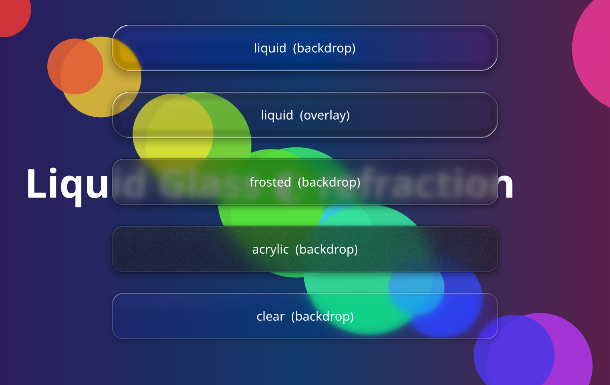

# Kogical.LiquidGlass

A reusable Qt Quick (Qt 6.8+) glass material: one QML item plus one fragment shader.
No Plasma or KDE dependencies — drop the folder into any CMake/Qt Quick project.



## Features

- **Liquid Glass** — convex lens bezel, angle-dependent specular rim (key + fill light),
  catch-light hairline, refraction darkening band, sheen, outside-only soft shadow.
- **Backdrop mode** — give it the `Item` behind it and it does *real* refraction,
  chromatic dispersion, blur ("frost") and saturation lift of that content.
- **Overlay mode** — without a backdrop it draws only the glass layers, designed to sit
  on top of compositor blur (KWin blur-behind, macOS vibrancy, etc.).
- Material recipes: `liquid`, `frosted`, `acrylic` (with grain), `clear`, `solid`,
  each with light/dark variants. Every parameter can be overridden.

## Use

```cmake
add_subdirectory(third_party/liquidglass)
target_link_libraries(myapp PRIVATE kogical_liquidglass)
```

```qml
import Kogical.LiquidGlass

Item {
    Image { id: wallpaper; anchors.fill: parent; source: "wall.jpg" }

    LiquidGlass {
        width: 520; height: 72; radius: 26
        material: "liquid"          // liquid | frosted | acrylic | clear | solid
        dark: true
        backdrop: wallpaper         // omit for overlay mode (compositor blur)
        highlight: 1.0              // any recipe value can be overridden
    }
}
```

The module is a static, plugin-less QML module that installs its files under
`qrc:/qt/qml/Kogical/LiquidGlass`, which is on Qt's default QML import path — linking the
target is all that is needed.

## Demo

```sh
cd examples/demo
cmake -S . -B build -G Ninja && cmake --build build
./build/liquidglass_demo                 # interactive
./build/liquidglass_demo --grab out.png  # render one frame to a PNG and exit
```

## Key properties

| Property | Meaning |
|---|---|
| `material`, `dark` | Recipe selection (see `GlassMaterials.qml`) |
| `radius` | Corner radius (px) |
| `tint`, `tintAlpha` | Body colour and opacity |
| `bezel`, `refraction`, `dispersion` | Lens width, displacement (px), RGB split |
| `frost`, `saturation`, `brightness` | Backdrop blur 0–1 and colour lift (backdrop mode) |
| `highlight`, `highlightWidth`, `lightAngle`, `sheen` | Rim specular and lighting |
| `edgeShade`, `grain` | Refraction darkening band, film grain |
| `innerBorderColor`, `outerBorderColor`, `borderWidth` | Dual hairline |
| `shadowColor`, `shadowBlur`, `shadowOffsetX/Y` | Outside-only drop shadow |
